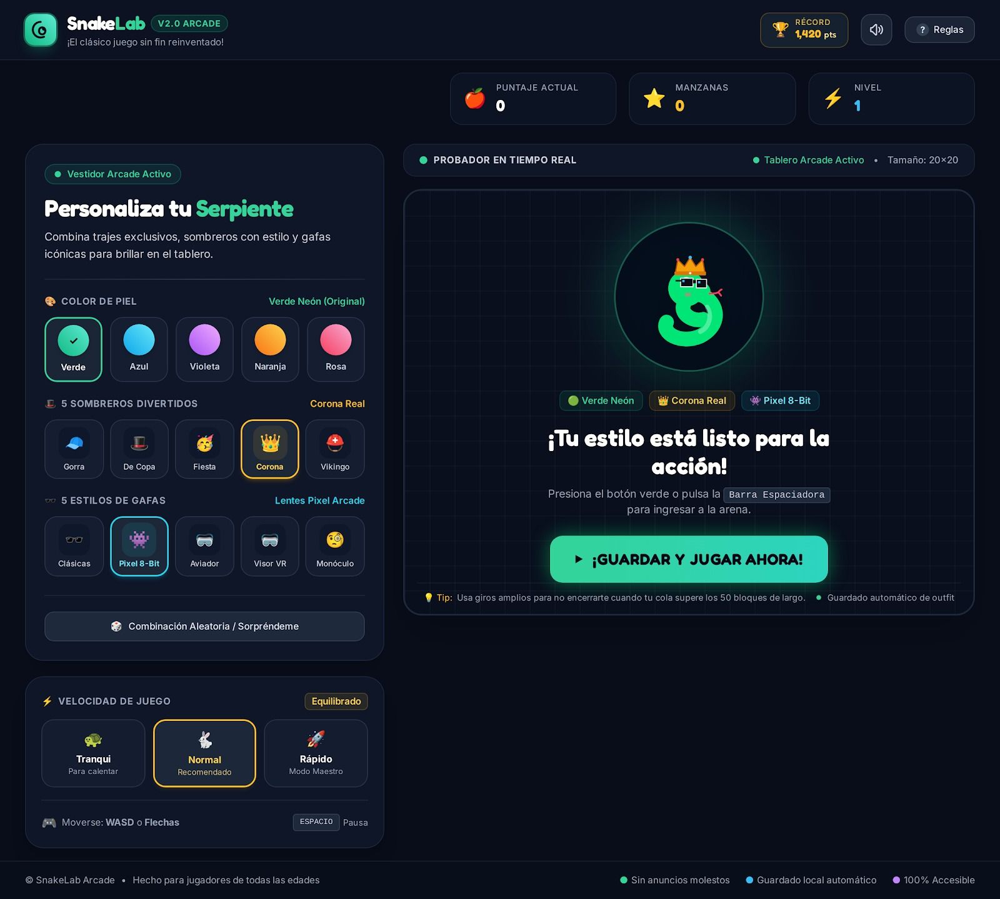
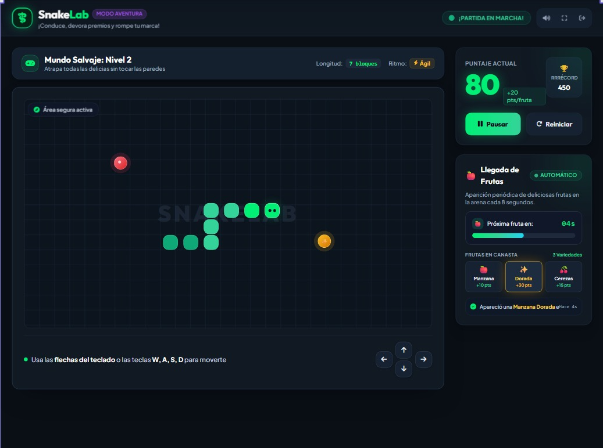

## Integrantes:
Christian Villa
Bryam Collaguazo
## Link del repositorio
https://github.com/bryan12-coder/icc-est-pl2-patrones.git

## Imagen Backup pantalla de inicio y pantalla de juego

>

>

## UML de los patrones implementados

*Lo hicimos en un cuaderno y despues le dijimos a la IA que solo lo organice.*

 ## Patron implementado: Abstract Factory

*Vamos a usar Abstract Factory porque nos permite crear cada tipo de comida junto con el efecto que le corresponde. Por ejemplo, la fábrica de comida de velocidad crea el alimento y el efecto que cambia el intervalo de movimiento de la serpiente. Así evitamos que, por error, esa comida active la puntuación doble.*

*Además, si más adelante queremos agregar otro potenciador, como una comida que ralentice a la serpiente, podemos crear su fábrica y su efecto y registrarlos como una nueva opción. La partida seguiría usando la misma interfaz para crear la comida y su efecto, así que el cambio se concentra en pocas clases.*

